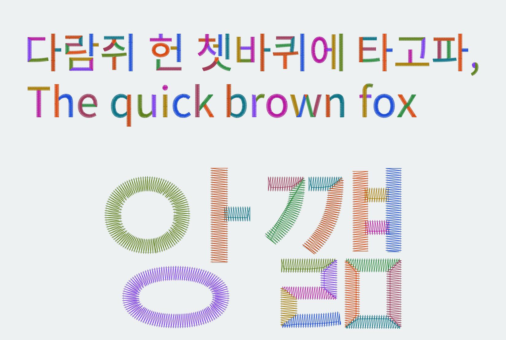

# hangul-satin

한글 TTF/OTF 폰트를 InkStitch lettering 폰트 폴더로 변환합니다. 획을 분석해서 satin 경로를 자동으로 만듭니다.



InkStitch satin 엔진이 만든 stitch 경로입니다. 색은 획을 뜻합니다. 글꼴은 Noto Sans KR(SIL Open Font License)이고, 굵기는 400입니다. 그림은 `scripts/readme_image.py`로 만듭니다.

개발 중입니다. 실제 자수 검증은 아직 끝나지 않았습니다. 설계는 `docs/superpowers/specs/`, 계획은 `docs/superpowers/plans/`에 있습니다.

## 설치

```bash
uv venv --python 3.13 && source .venv/bin/activate
uv pip install --no-deps "inkex @ git+https://gitlab.com/CapellanCitizen/extensions.git@a887f9d4c8adacd62786e4f46c8ef1467bedc1df"
uv pip install -e ".[dev]" pystitch lxml platformdirs "jinja2>2.9" colormath2 "flask>=2.2" trimesh xxhash diskcache wxPython cssselect tinycss2 packaging pyparsing scour
```

폰트 폴더만 만들 때는 InkStitch가 필요 없습니다. `--check`, 테스트, 페이지 생성에는 InkStitch checkout이 필요합니다. 위치는 `INKSTITCH_PATH`로 지정합니다. 기본값은 `~/tmp/InkStitch`입니다.

## 사용법

```bash
hangul-satin "MyFont.otf" --chars "가나다" --size 30 --out out/myfont --check
hangul-satin "MyFont.otf" --charset ks-x-1001 --size 30 --out out/myfont
```

- `--check`는 글자마다 InkStitch로 stitch를 만들어서 기준을 넘지 못한 글자를 알려 줍니다.
- 결과는 `report.json`에 저장합니다.
- 결과 폴더를 InkStitch의 사용자 폰트 폴더에 넣으면 Lettering에 나타납니다. Inkscape 화면에서는 아직 확인하지 않았습니다.
- InkStitch는 렌더링 때 모든 글리프를 읽습니다. KS X 1001 2,350자 폰트는 첫 렌더링에 약 30초가 걸립니다.

## 동작 방식

1. 글자 외곽선에서 직선 기둥을 찾습니다.
2. 기둥과 곁획은 축에 수직인 평행 stitch로 만듭니다.
3. 기둥이 없는 부분은 centerline으로 처리합니다. 고리는 방사형이고, 뾰족한 모서리는 대각선으로 나눕니다.
4. 덮이지 않은 영역은 이웃 획에 합치거나 별도 조각으로 수놓습니다.

## 테스트

```bash
python -m pytest
INKSTITCH_TEST_FONT_DIR=~/Downloads/CookieRunFont_OTF python -m pytest
```

두 번째 명령은 로컬에 있는 CookieRun 폰트로 회귀 테스트를 추가 실행합니다.

## 라이선스

GPL-3.0-or-later. 이 도구는 InkStitch(GPL-3.0-or-later)를 함께 사용합니다.

변환 결과는 원본 폰트의 파생물일 수 있습니다. 공유하거나 배포하기 전에 폰트 라이선스를 확인하세요. 이 저장소에는 폰트 파일과 그 파생물을 넣지 않습니다.
